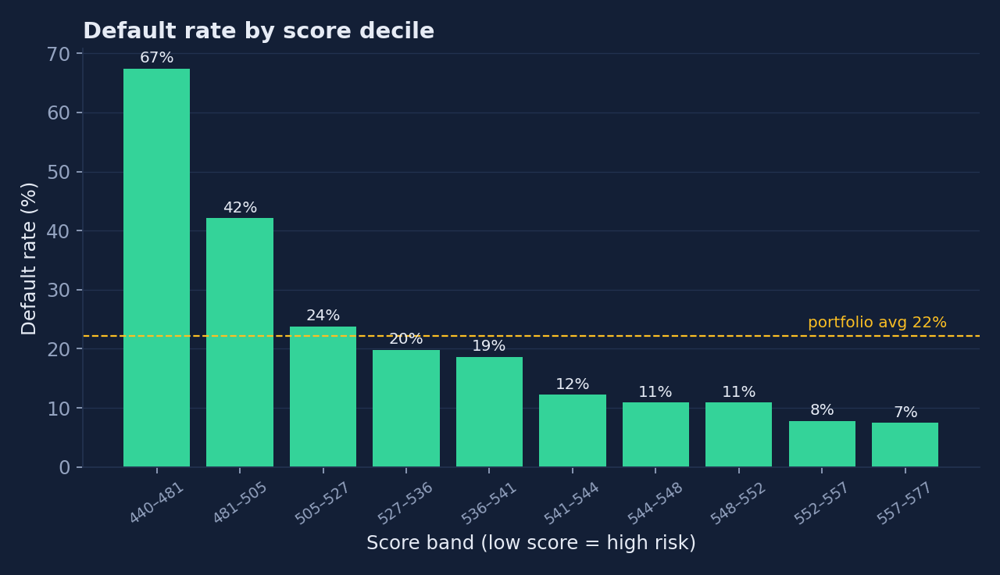
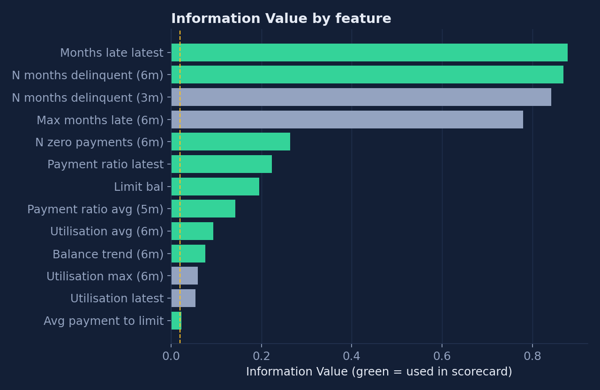
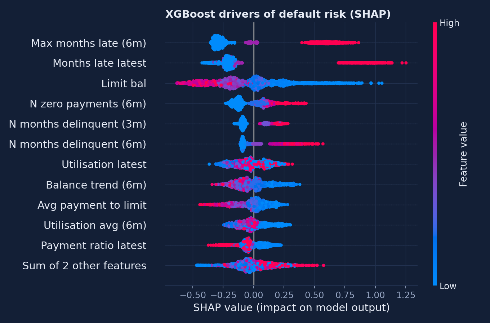
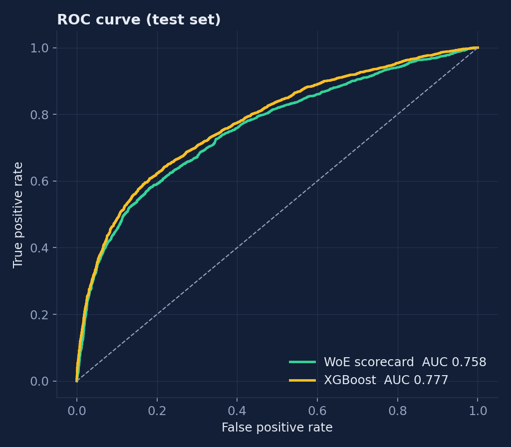
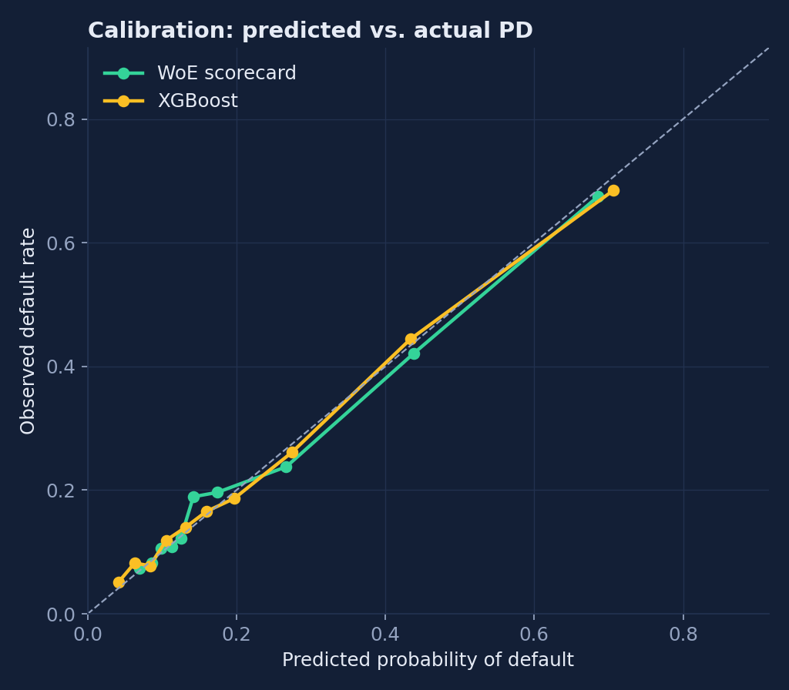
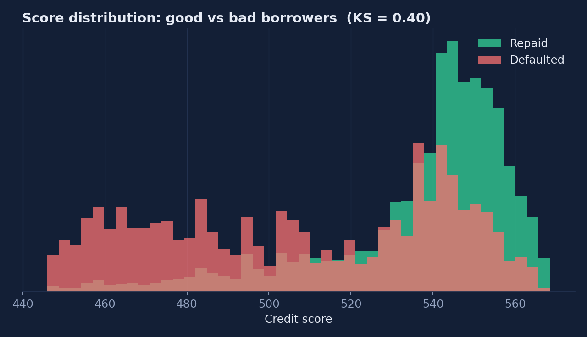
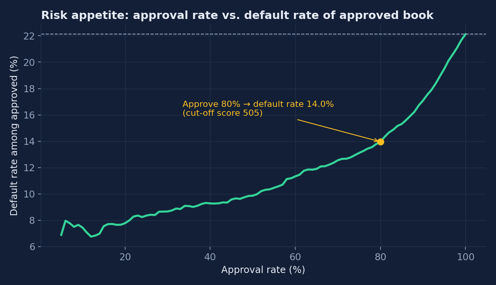

# Credit Risk Scoring Model

A probability-of-default (PD) model and points-based **credit scorecard** built the way banks build them: Weight-of-Evidence binning, a sign-constrained logistic regression and score scaling. It is benchmarked against an **XGBoost** challenger explained with **SHAP**.

> I built credit scoring models and risk frameworks in the Risk Department of a commercial bank. That work is confidential, so this project rebuilds the same methodology on public data.



## Results (held-out test set, 9,000 borrowers)

| Model | AUC | Gini | KS | Brier |
|---|---|---|---|---|
| **WoE scorecard** (9 features, fully explainable) | 0.758 | 0.515 | 0.397 | 0.140 |
| **XGBoost** challenger (13 features) | 0.777 | 0.554 | 0.427 | 0.135 |

**Business impact:**
- **Risk ranking:** borrowers in the lowest score decile default at **67%**, while the highest decile defaults at **7.5%**, a 9× separation.
- **Approval policy:** with a cut-off score of **505** the lender approves 80% of applicants, and the default rate in the approved book falls from **22.1% to 14.0%**, a **37% reduction**.
- **Champion vs. challenger:** XGBoost adds about 4 Gini points. The scorecard stays the recommended production model, because every decision can be traced to points on a table, which regulators and credit committees expect. XGBoost remains useful as a benchmark and for monitoring.

## Data

[UCI: Default of Credit Card Clients](https://archive.ics.uci.edu/dataset/350/default+of+credit+card+clients) covers 30,000 credit card holders from a Taiwanese bank, with 6 months of repayment status, bill amounts and payments. The default rate is 22.1%.

**Fair lending:** sex, marital status, education and age are deliberately **excluded**. The model scores credit *behavior*, not demographics.

## Method

### 1. Feature engineering ([`src/data.py`](src/data.py))
Thirteen behavioral features of the kind a credit bureau produces, built from the raw monthly history:

| Group | Features |
|---|---|
| Delinquency | months late (latest), max months late (6m), # delinquent months (3m / 6m) |
| Utilization | latest, average and max balance ÷ limit; 6-month balance trend |
| Repayment | payment ÷ prior bill (latest and 5-month average), # zero-payment months, average payment ÷ limit |
| Capacity | credit limit |

### 2. Weight-of-Evidence binning ([`src/woe.py`](src/woe.py), written from scratch)
- Starts from quantile bins, then merges any bin under 5% of the population.
- Merges neighboring bins until the bad rate moves in **one direction only** across the bins, so the score always moves in the expected direction.
- WoE = ln(%good / %bad) and Information Value are computed for each feature.



### 3. Scorecard ([`src/scorecard.py`](src/scorecard.py))
- **Feature selection:** keep features with IV ≥ 0.02 and drop the weaker of any pair whose WoE correlation exceeds 0.75.
- **Logistic regression** on the WoE values, with a **sign check**: any feature with a coefficient that contradicts the WoE logic is removed and the model is refit.
- **Score scaling:** 600 points = 50:1 good:bad odds, and every 20 points (PDO) doubles the odds.

Example rows from the points table ([`reports/scorecard_points.csv`](reports/scorecard_points.csv)):

| Feature | Bin | Default rate | Points |
|---|---|---|---|
| Months late (latest) | on time | 14% | 68 |
| | 1 month | 34% | 47 |
| | 2+ months | 70% | 21 |
| Credit limit | ≤ 30K | 37% | 48 |
| | 140K–210K | 17% | 62 |
| | > 360K | 12% | 69 |

### 4. XGBoost challenger and SHAP
A gradient-boosted model with early stopping (584 trees), explained using exact TreeSHAP values. The strongest drivers are recent and maximum delinquency, then credit limit and the number of months with no payment. These match the scorecard's IV ranking, which is a good sign that both models picked up the same risk signals.



### 5. Validation
| | |
|---|---|
|  |  |




## Run it

```bash
python -m venv .venv
.venv\Scripts\activate        # Windows (macOS/Linux: source .venv/bin/activate)
pip install -r requirements.txt
```

Download the dataset from UCI and place `default of credit card clients.xls` in `data/raw/`, then:

```bash
python train.py
```

This writes `reports/metrics.json`, the scorecard points table, the WoE bins, the score bands and all the charts.

## Project structure

```
credit-risk-scoring/
├── train.py            # end-to-end pipeline
├── src/
│   ├── data.py         # loading + feature engineering
│   ├── woe.py          # monotonic WoE binning + IV
│   ├── scorecard.py    # feature selection, logistic regression, points scaling
│   └── evaluate.py     # AUC / Gini / KS / Brier, score bands, approval trade-off
└── reports/            # metrics.json, CSV tables, figures/
```

## Limitations and next steps
- There is no **out-of-time** validation: the dataset covers only one 6-month window, so a random split stands in for it.
- Next: a **PSI / stability** monitoring report, **reject inference**, and **Expected Loss** (PD × LGD × EAD) for loss-based cut-off optimization.

---
**Joey El Gemayel**, Financial Data Scientist · [LinkedIn](https://linkedin.com/in/joey-el-gemayel-682924b0)
